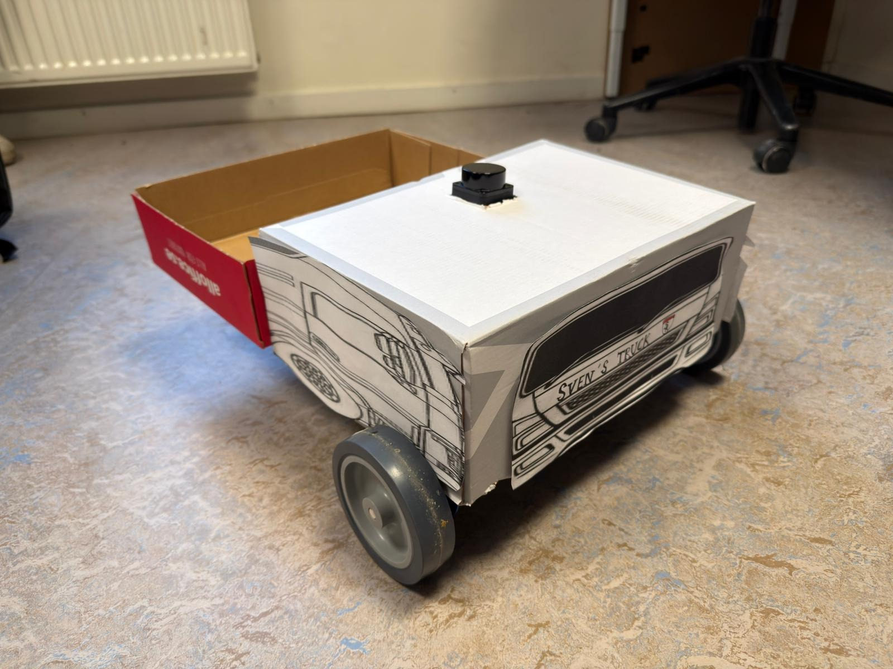
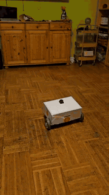
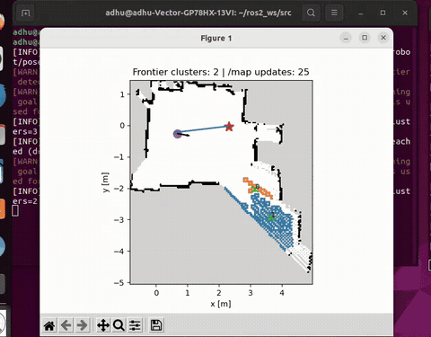
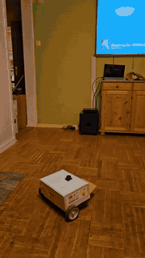
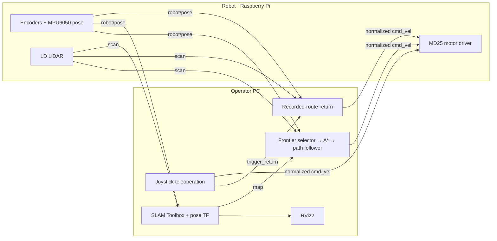
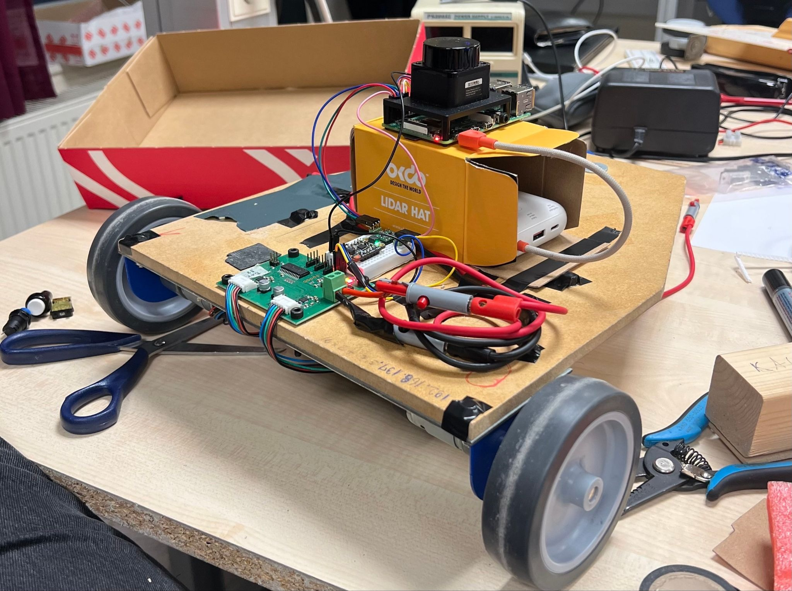

# RoverLink · Teleoperation, Teach-and-Return & Exploration

**ROS 2 · Differential-drive robot · Wi-Fi DDS · LiDAR · A-star · Python**

RoverLink connects an operator PC to a mobile robot for joystick driving, recorded-route return and frontier exploration. The PC handles user input, planning, SLAM and visualization; the robot handles motors, encoders, IMU and LiDAR. The two sides exchange ROS topics over Wi-Fi.

The project explores a practical question: after an operator teaches a route, how can a robot follow it back while reacting to obstacles? A separate exploration mode selects frontiers, plans through an occupancy grid and tracks the resulting path.

Frontier exploration is one part of the broader teleoperation and return workflow. A dedicated [TurtleBot3 exploration project using ROS 2 Jazzy](https://github.com/ADHU-ADHU/turtlebot3-hybrid-exploration-ros2) is also available.

*The finished robot platform. [Hardware photos and source details](docs/assets/README.md).*

## Recorded demos

| Physical robot | Frontier planning map |
| :---: | :---: |
| **Run 1** | **Run 1** |
|  |  |
| [Watch Run 1](https://drive.google.com/file/d/1N3Wnz_RERe_v0gNNwyVqRQkU6eJ4O28J/view) | [Watch Run 1 frontier map](https://drive.google.com/file/d/1N3GdqE0HkIV_c7-GcsQj2JF_T-2GK5UM/view) |
| **Run 2** | **Run 2 · disturbance recording** |
|  |  |
| [Watch Run 2](https://drive.google.com/file/d/1L8eBylxhtYKRo3VYYARCjCyfaFWwbkDD/view) | [Watch Run 2 frontier map](https://drive.google.com/file/d/1a5PYxGajpSwgzHGgYuOJLI3B1tPuujmC/view) |

*Corresponding robot and frontier views for each run. Previews play independently at normal speed.*

[Full recordings and desktop previews · all seven videos →](docs/demos/README.md#all-seven-recordings)

[Setup and operation](docs/setup.md) · [Architecture and topic contracts](docs/architecture.md) · [Experiments](experiments/README.md) · [Validation and limitations](docs/validation.md) · [Reflection report](docs/reports/reflection-report.pdf)

## What I built

- **Joystick teleoperation and handover:** pygame input, normalized drive commands, debounced return trigger and a stop burst before manual publishing pauses.
- **Teach-and-return control:** record the driven pose history, reverse and subsample it, then track waypoints toward the origin.
- **LiDAR obstacle handling:** turn/drive avoidance states, path rejoining, hysteresis, minimum turn duration and cooldown tuning.
- **Frontier exploration:** cluster frontier candidates, plan with inflated-grid A*, shorten paths with Bresenham line-of-sight checks, smooth them with a moving average and track them with local obstacle handling.
- **Experiments:** Gaussian smoothing of recorded routes, gyro/encoder heading fusion, and an [OR-Tools TSP prototype for multi-stop routing](experiments/multi_stop/tsp_prototype.py).
- **PC/robot integration:** Wi-Fi ROS communication, a pose-to-TF bridge, and SLAM configuration and tuning alongside the wider robot integration work.

**Author:** Adhithya Palanisamy Chandrasekaran. This repository presents my control and planning work. SLAM Toolbox and the LD LiDAR driver are external components; their algorithms are not claimed as my implementation. See [source provenance and dependencies](docs/provenance.md).

### Multi-stop routing with OR-Tools

The [TSP prototype](experiments/multi_stop/tsp_prototype.py) takes entered waypoints, builds an OR-Tools routing model and passes the selected visit order to a differential-drive follower. It is a separate experiment with known distance-precision and route-handling limits, documented in the [experiment notes](experiments/README.md); it is not part of the recorded return-control chain.

## How the two sides fit together

Return control is placed on the PC in this layout; it has no direct hardware dependency. Only the robot-side driver writes motor commands. Manual/return and exploration are separate operating modes.

## Hardware

| Component | Role |
| --- | --- |
| Raspberry Pi 4, 2 GB | Onboard ROS nodes and hardware interfaces |
| MD25 dual motor controller | I²C differential-drive commands and encoder access |
| Two EMG30 geared motors with encoders | Drive and wheel-displacement measurement |
| MPU6050 IMU | Angular-rate input and integrated heading |
| LDROBOT 2D LiDAR, LD06 launch profile | `/scan` for SLAM and local obstacle handling |
| Operator PC and game controller | Joystick input, planning, SLAM and visualization |
| Wi-Fi | ROS DDS communication between PC and robot |

*Assembly photo from the shared platform documentation; this portfolio focuses on my software contributions. The driver configuration and recorded commands use the LD06 profile; the wider report also refers to LD19, so the exact sensor model should be checked against the physical unit before reproducing the wiring.*

## Repository map

| Location | Purpose |
| --- | --- |
| [`pc/ros2_ws/src/roverlink_control`](pc/ros2_ws/src/roverlink_control) | Joystick, return, frontier selection, A* and path tracking nodes |
| [`pc/ros2_ws/src/robot_slam_bringup`](pc/ros2_ws/src/robot_slam_bringup) | Pose-to-TF bridge and SLAM parameters |
| [`robot/ros2_ws/src`](robot/ros2_ws/src) | MD25 drive and MPU6050/encoder packages |
| [`dependencies`](dependencies) | Pinned external LiDAR driver reference |
| [`experiments`](experiments) | Separate smoothing, heading-fusion and routing prototypes |
| [`docs/demos`](docs/demos) | Physical runs and recorded desktop previews |

## Status

The supplied recordings show physical robot operation, SLAM visualization and the frontier-planning components. The source comes from the supplied PC/robot archives and the recovered working workspaces, with original-to-public filename mapping recorded in the [source manifest](docs/source-manifest.json).

The robot was developed with **ROS 2 Humble**. Packaging is checked separately on **ROS 2 Jazzy**; this does not establish a hardware migration. This is a working experimental platform with implementation limits documented alongside the run instructions. Gaussian smoothing and Kalman-filter variants are separate experiments, and the multi-stop solver is not an integrated autonomous mission.

**Interface detail:** `/cmd_vel` carries custom normalized forward/turn values in `[-1, 1]`, and `/robot/pose.theta` is in **degrees**. Use the supplied matching nodes and consult the [topic contracts](docs/architecture.md) before connecting other software.
