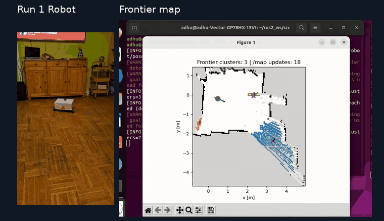
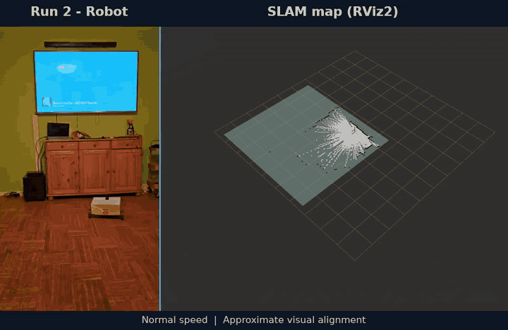
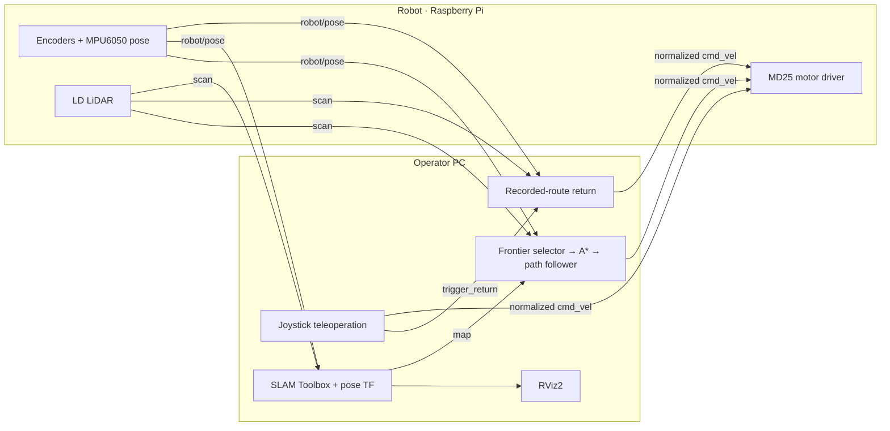

# ROS 2 Mobile Robot Platform

**Hardware Integration · Teleoperation · Return to Base · SLAM · ROS 2 · Python**

A working mobile robot built from scratch by integrating drive hardware, an onboard computer, wheel encoders, an IMU and LiDAR through ROS 2. The platform supports remote control, live sensor feedback and commanded return to base.

The PC provides the operator interface, mapping and visualization. The onboard Raspberry Pi handles motor commands, wheel encoders, inertial sensing and LiDAR. ROS 2 connects both sides over Wi-Fi.

## Teleoperation and return workflow

1. **Drive remotely:** the operator controls travel using live LiDAR, pose and map feedback.
2. **Record the route:** encoder and gyro-based pose estimates retain the driven trajectory.
3. **Command return to base:** manual publishing pauses and the return controller follows the recorded route back toward the start.
4. **Handle obstacles locally:** LiDAR-based turn/drive avoidance attempts to rejoin the return path.

The goal was to build and integrate a working robot from individual components. An example brief—remotely delivering equipment through indoor corridors and returning to base on command—motivated the teleoperation, sensing and return-control functions. See [project context and implementation coverage](docs/project-context.md) for what was requested and what this repository implements.

Frontier exploration is an additional capability. A dedicated [TurtleBot3 exploration implementation using ROS 2 Jazzy](https://github.com/ADHU-ADHU/turtlebot3-hybrid-exploration-ros2) is available separately.

*The assembled mobile robot platform. [Hardware and supplied resources](docs/hardware.md) · [Hardware photos](docs/assets/README.md).*

## Recorded demos

Physical robot runs alongside recorded mapping and exploration displays.

### Run 1 · Robot and frontier planning

[Watch original robot video](https://drive.google.com/file/d/1N3Wnz_RERe_v0gNNwyVqRQkU6eJ4O28J/view) · [Watch full frontier recording](https://drive.google.com/file/d/1N3GdqE0HkIV_c7-GcsQj2JF_T-2GK5UM/view) · [Download paired MP4](https://raw.githubusercontent.com/ADHU-ADHU/mobile-robot-platform-ros2/main/docs/demos/run-1-robot-frontier.mp4)

### Run 2 · Robot and SLAM

[Watch original robot video](https://drive.google.com/file/d/1L8eBylxhtYKRo3VYYARCjCyfaFWwbkDD/view) · [Watch full SLAM recording](https://drive.google.com/file/d/1JzWEIaSQ2RWp_wPCHWGMkrtPHqy_iAXB/view) · [Download paired MP4](https://raw.githubusercontent.com/ADHU-ADHU/mobile-robot-platform-ros2/main/docs/demos/run-2-robot-slam.mp4)

*Each pair uses one playback clock, so both panels start and loop together at normal speed. Full robot runs are shown beside selected desktop windows; motion alignment is approximate because the sources have no shared timestamp.*

### Dedicated hybrid exploration project

Exploration is one component of this mobile robot platform. My dedicated [TurtleBot3 Hybrid Exploration with ROS 2 Jazzy](https://github.com/ADHU-ADHU/turtlebot3-hybrid-exploration-ros2) repository covers the exploration pipeline in depth: frontier selection, A* planning and smoothing, reactive LiDAR obstacle avoidance, algorithm documentation, and simulation and physical-robot results.

[Full recordings and desktop previews · all seven originals, including the separate disturbance recordings →](docs/demos/README.md#all-seven-recordings)

[Setup and operation](docs/setup.md) · [Architecture and topic contracts](docs/architecture.md) · [Experiments](experiments/README.md) · [Validation and limitations](docs/validation.md) · [Reflection report](docs/reports/reflection-report.pdf)

## What I built

- **Joystick teleoperation and handover:** pygame input, normalized drive commands, debounced return trigger and a stop burst before manual publishing pauses.
- **Teach-and-return control:** record the driven pose history, reverse and subsample it, then track waypoints toward the origin.
- **LiDAR obstacle handling:** turn/drive avoidance states, path rejoining, hysteresis, minimum turn duration and cooldown tuning.
- **PC/robot integration:** Wi-Fi ROS communication, a pose-to-TF bridge, and SLAM configuration and tuning alongside the wider robot integration work.

**Author:** Adhithya Palanisamy Chandrasekaran. This repository presents my control and planning work. SLAM Toolbox and the LD LiDAR driver are external components; their algorithms are not claimed as my implementation. See [source provenance and dependencies](docs/provenance.md).

## Additional work and experiments

- **Frontier exploration:** frontier clustering, inflated-grid A*, line-of-sight shortcutting, moving-average smoothing and local path tracking. This extends the platform beyond the example teleoperation-and-return task.
- **Route smoothing:** a separate Gaussian-filtered return experiment.
- **Heading fusion:** scalar and heading/gyro-bias Kalman-filter notebook variants, separate from the main pose node.
- **Multi-stop routing:** an [OR-Tools TSP prototype](experiments/multi_stop/tsp_prototype.py) orders entered waypoints and passes them to a motor-control follower. It has known distance-precision and route-handling limitations and is separate from the recorded return-control chain.

[Experiment details and current limits →](experiments/README.md)

## How the two sides fit together

Return control is placed on the PC in this layout; it has no direct hardware dependency. Only the robot-side driver writes motor commands. Manual/return and exploration are separate operating modes.

## Hardware

The platform uses **differential drive**: two separately controlled motors steer it by varying the left and right wheel speeds.

| Component | Role |
| --- | --- |
| Raspberry Pi 4 | Onboard ROS nodes and hardware interfaces |
| MD25 dual motor controller | I²C control of the two motors and encoder access |
| Two EMG30 geared motors with encoders | Drive and wheel-displacement measurement |
| MPU-series IMU | Angular-rate input and heading; the supplied node uses the MPU6050 interface |
| LDROBOT 2D LiDAR | Live scans for operator feedback, mapping and obstacle handling; LD06 software profile included |
| Operator PC and game controller | Joystick input, planning, SLAM and visualization |
| Wi-Fi access point | ROS DDS communication between PC and robot |
| Power and supporting hardware | 12 V battery, USB power resources and emergency-stop hardware listed in the supplied equipment |

*The published software targets MPU6050 and LD06 interfaces. [Hardware notes](docs/hardware.md) cover sensor configuration, power, networking and additional development resources.*

## Repository map

| Location | Purpose |
| --- | --- |
| [`pc/ros2_ws/src/roverlink_control`](pc/ros2_ws/src/roverlink_control) | Joystick, return, frontier selection, A* and path tracking nodes |
| [`pc/ros2_ws/src/robot_slam_bringup`](pc/ros2_ws/src/robot_slam_bringup) | Pose-to-TF bridge and SLAM parameters |
| [`robot/ros2_ws/src`](robot/ros2_ws/src) | MD25 drive and MPU6050/encoder packages |
| [`dependencies`](dependencies) | Pinned external LiDAR driver reference |
| [`experiments`](experiments) | Separate smoothing, heading-fusion and routing prototypes |
| [`docs/demos`](docs/demos) | Physical runs and recorded desktop previews |

## Status

The supplied recordings show physical robot operation, SLAM visualization and the frontier-planning components. The source comes from the supplied PC/robot archives and the recovered working workspaces, with original-to-public filename mapping recorded in the [source manifest](docs/source-manifest.json).

The robot was developed with **ROS 2 Humble**. Packaging is checked separately on **ROS 2 Jazzy**; this does not establish a hardware migration. This is a working experimental platform with implementation limits documented alongside the run instructions. Gaussian smoothing and Kalman-filter variants are separate experiments, and the multi-stop solver is not an integrated autonomous mission.

**Interface detail:** `/cmd_vel` carries custom normalized forward/turn values in `[-1, 1]`, and `/robot/pose.theta` is in **degrees**. Use the supplied matching nodes and consult the [topic contracts](docs/architecture.md) before connecting other software.
