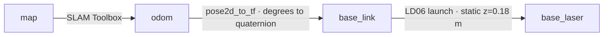
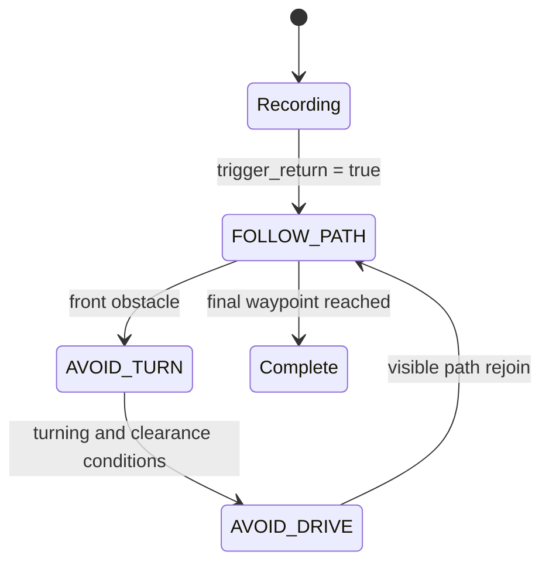

# Architecture and interfaces

## Deployment

The operator PC and robot share a ROS domain over Wi-Fi. The recorded setup uses domain **10**. Both machines need compatible ROS middleware, mutual network reachability and synchronized startup frames. The source was developed on ROS 2 Humble.

| PC | Robot |
| --- | --- |
| pygame joystick → `teleop_joystick` | `md25_simple/md25_controller` → MD25 + EMG30 motors |
| `return_controller` records and follows poses | `mpu6050_ros2` → encoder/gyro pose and raw IMU |
| `frontier_selector`, `astar_planner`, `path_follower` | External `ldlidar_ros2` LD06 launch profile → scans |
| `robot_slam_bringup/pose2d_to_tf` | Sensor frame `base_laser` → `base_link` static transform |
| SLAM Toolbox and RViz2 | Raspberry Pi 4 / I²C and serial devices |

Only one motor driver may own the MD25. The main graph uses normalized commands and is different from legacy SI-unit or direct-I²C controller variants.

## Topic contracts

Topic names assume the default root namespace. Relative `cmd_vel` names resolve to `/cmd_vel` in the documented commands.

| Topic | Message | Contract |
| --- | --- | --- |
| `/cmd_vel` | `geometry_msgs/Twist` | `linear.x` forward and `angular.z` turn: custom normalized `[-1,1]`, not SI velocity. The driver performs mixing and turn inversion. |
| `/trigger_return` | `std_msgs/Bool` | `True` starts return if not already returning. `False` does not cancel it. |
| `/robot/pose` | `geometry_msgs/Pose2D` | x/y in metres; theta in degrees. Encoder displacement with gyro-derived heading. |
| `/robot/pose_enc` | `geometry_msgs/Pose2D` | Encoder-only comparison pose, also degrees. |
| `/robot/imu_raw` | `sensor_msgs/Imu` | Angular velocity in rad/s. Source does not populate a complete standard header/orientation/covariance contract. |
| `/robot/imu` | `geometry_msgs/Twist` | Packed legacy diagnostics: angular.x raw gyro z, angular.y bias, angular.z integrated heading in degrees. Not a velocity command. |
| `/robot/distance_travelled` | `std_msgs/Float64` | Travel estimate in metres. |
| `/scan` | `sensor_msgs/LaserScan` | External LiDAR driver, frame `base_laser`. |
| `/map` | `nav_msgs/OccupancyGrid` | SLAM Toolbox occupancy grid. Unknown cells are blocked in planning. |
| `/frontier_goal` | `geometry_msgs/PoseStamped` | Frontier goal used by all three published exploration nodes. |
| `/planned_path` | `nav_msgs/Path` | A* path with shortcutting and moving-average smoothing. |
| `/frontier_next` | `std_msgs/Bool` | Request a subsequent frontier. |
| `/replan` | `std_msgs/Bool` | Request replanning from the current pose. |

The published follower's frontier-goal subscription was corrected from `PointStamped` to `PoseStamped` to match the selector and planner. No path-control algorithm was changed by this correction.

## Frames and planning

The exploration scripts use `/robot/pose` coordinates directly against the grid. They do not transform the robot pose through `map → odom`. A growing correction between these frames can therefore misalign planning and tracking. The pose bridge itself broadcasts only `odom → base_link`.

Frontiers are free cells adjacent to unknown space. The selector groups them, chooses representative frontier cells and ranks candidates by robot distance. The planner inflates obstacles, searches eight neighbors, checks line-of-sight shortcuts and smooths waypoints. The follower tracks these waypoints and requests a new plan or frontier as progress changes. Moving-average smoothing is not followed by a full swept-footprint collision validation.

## Return control

The return controller records the driven Pose2D history while the operator drives. A return trigger reverses and subsamples that history, appends the fixed origin `(0,0)`, and switches to waypoint tracking. The supplied implementation assumes the teaching run began at that origin.

The extended implementation includes a minimum turn, hysteresis, cooldown and a committed forward segment to reduce oscillation. These are heuristic local decisions, not a collision-free guarantee. The documented reference setting `avoid_turn_sign=-1.0` matches the included driver's default `invert_turn=True`; wheel polarity and sensor alignment must be confirmed on the actual robot.
