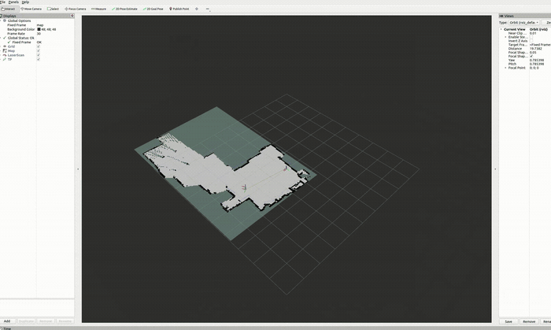

# Recorded demos

All **seven full recordings** are linked below: two physical robot runs, two frontier-planning captures and three SLAM/terminal captures. Drive links open the original videos for browser playback. The GIFs are short, normal-speed previews; the two compact MP4 copies are also available as downloads.

## All seven recordings

| Recording | Duration | Full video |
| --- | ---: | --- |
| Physical robot · Run 1 | 0:40 | [Watch full recording](https://drive.google.com/file/d/1N3Wnz_RERe_v0gNNwyVqRQkU6eJ4O28J/view?usp=drivesdk) |
| Physical robot · Run 2 | 0:35 | [Watch full recording](https://drive.google.com/file/d/1L8eBylxhtYKRo3VYYARCjCyfaFWwbkDD/view?usp=drivesdk) |
| Frontier planning map · Run 1 · without disturbance | 1:07 | [Watch full recording](https://drive.google.com/file/d/1N3GdqE0HkIV_c7-GcsQj2JF_T-2GK5UM/view?usp=drivesdk) |
| Frontier planning map · Run 2 · with disturbance | 1:18 | [Watch full recording](https://drive.google.com/file/d/1a5PYxGajpSwgzHGgYuOJLI3B1tPuujmC/view?usp=drivesdk) |
| SLAM and terminals · without disturbance · Run 1 | 2:04 | [Watch full recording](https://drive.google.com/file/d/17GfGzLKmsFYkC4zHKYkuDDoeN6FWufPo/view?usp=drivesdk) |
| SLAM and terminals · without disturbance · Run 2 | 1:53 | [Watch full recording](https://drive.google.com/file/d/1JzWEIaSQ2RWp_wPCHWGMkrtPHqy_iAXB/view?usp=drivesdk) |
| SLAM and terminals · with disturbance | 2:37 | [Watch full recording](https://drive.google.com/file/d/1yc3GqGitcGwUOFBiwv69zqKGgYtH1DC7/view?usp=drivesdk) |

“Without disturbance” and “with disturbance” follow the supplied recording labels. The desktop videos show the software displays; they do not show the applied physical disturbance. The two similarly named Run 1 WEBM files are different captures: one shows the frontier plot, the other SLAM and terminals. Their exact original filenames are retained in the [recording manifest](original-media-manifest.json).

## Physical robot

| Run 1 | Run 2 |
| --- | --- |
|  |  |
| [Watch on Drive](https://drive.google.com/file/d/1N3Wnz_RERe_v0gNNwyVqRQkU6eJ4O28J/view?usp=drivesdk) · [Download silent MP4 — 40 seconds, 3.21 MB](https://raw.githubusercontent.com/ADHU-ADHU/roverlink-ros2/main/docs/demos/run-1-live.mp4) | [Watch on Drive](https://drive.google.com/file/d/1L8eBylxhtYKRo3VYYARCjCyfaFWwbkDD/view?usp=drivesdk) · [Download silent MP4 — 35 seconds, 2.45 MB](https://raw.githubusercontent.com/ADHU-ADHU/roverlink-ros2/main/docs/demos/run-2-live.mp4) |

These clips show the physical platform moving around furniture. The camera footage alone does not identify the active controller or distinguish teleoperation from autonomous motion. The GIFs show source seconds 5–15 of Run 1 and 7–17 of Run 2. The MP4s retain the full supplied video duration and framing; audio has been removed.

## Frontier planning displays

| Run 1 | Run 2 · disturbance recording |
| :---: | :---: |
|  |  |
| [Watch Run 1 frontier map](https://drive.google.com/file/d/1N3GdqE0HkIV_c7-GcsQj2JF_T-2GK5UM/view) | [Watch Run 2 frontier map](https://drive.google.com/file/d/1a5PYxGajpSwgzHGgYuOJLI3B1tPuujmC/view) |

The author identifies `frontier_exploration_no_distrubance_run1.webm` as Run 1's frontier view and `Frontier_explorer_with_disturbance.webm` as Run 2's frontier view. The front page places each beside its corresponding physical run. The excerpts retain normal speed and are not synchronized with the camera clips. Exact excerpt windows are in the [prepared media manifest](prepared-media-manifest.json).

Startup commands reference `frontier_explorer55.py`, `a*_smooth5.py` and `path_follower5.py`. These support the recorded components without establishing byte-identical source revisions.

## SLAM in RViz2 and terminals

[Watch without disturbance · Run 1](https://drive.google.com/file/d/17GfGzLKmsFYkC4zHKYkuDDoeN6FWufPo/view?usp=drivesdk) · [Watch without disturbance · Run 2](https://drive.google.com/file/d/1JzWEIaSQ2RWp_wPCHWGMkrtPHqy_iAXB/view?usp=drivesdk) · [Watch with disturbance](https://drive.google.com/file/d/1yc3GqGitcGwUOFBiwv69zqKGgYtH1DC7/view?usp=drivesdk)

The preview is an 18-second excerpt of the first SLAM recording, source seconds 86–104. The full captures include robot-side LiDAR, IMU and motor-controller startup, alongside PC-side SLAM Toolbox, the pose-to-TF bridge and RViz2.

## Media provenance

- [Original recording manifest](original-media-manifest.json): all seven source filenames, hashes, sizes, durations, public watch links and access-check details. Each unique recording had a byte-identical nested duplicate in the supplied folder.
- [Prepared media manifest](prepared-media-manifest.json): excerpt windows, crops, encoding settings and output hashes for the published previews and MP4 downloads.

All seven Drive links point to full originals and had “Anyone with the link — Viewer” access when checked. No sharing permissions were changed. The local original recordings remain unchanged. The two published MP4 copies use H.264 with browser-compatible pixel format and faststart metadata; both were decoded in full without errors. GIFs use reduced dimensions, frame rates and colour palettes for a smaller preview. No playback speed changes or synthetic imagery were added. GitHub's file viewer may offer MP4 downloads instead of playback, so use the Drive links to watch.
