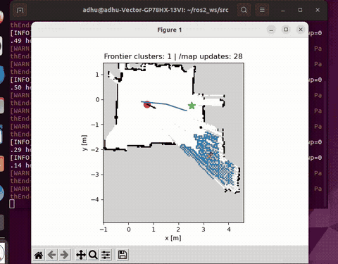

# Recorded demos

All **seven full recordings** are linked below: two physical robot runs, two frontier-planning captures and three SLAM/terminal captures. Drive links open the original videos for browser playback. The paired views below show each full robot run beside a selected desktop window using one playback clock. The seven original recordings remain available separately, including the disturbance captures.

## All seven recordings

| Recording | Duration | Full video |
| --- | ---: | --- |
| Physical robot · Run 1 | 0:40 | [Watch full recording](https://drive.google.com/file/d/1N3Wnz_RERe_v0gNNwyVqRQkU6eJ4O28J/view?usp=drivesdk) |
| Physical robot · Run 2 | 0:35 | [Watch full recording](https://drive.google.com/file/d/1L8eBylxhtYKRo3VYYARCjCyfaFWwbkDD/view?usp=drivesdk) |
| Frontier planning map · Run 1 · without disturbance | 1:07 | [Watch full recording](https://drive.google.com/file/d/1N3GdqE0HkIV_c7-GcsQj2JF_T-2GK5UM/view?usp=drivesdk) |
| Frontier planning map · standalone disturbance recording | 1:18 | [Watch full recording](https://drive.google.com/file/d/1a5PYxGajpSwgzHGgYuOJLI3B1tPuujmC/view?usp=drivesdk) |
| SLAM and terminals · without disturbance · Run 1 | 2:04 | [Watch full recording](https://drive.google.com/file/d/17GfGzLKmsFYkC4zHKYkuDDoeN6FWufPo/view?usp=drivesdk) |
| SLAM and terminals · without disturbance · Run 2 | 1:53 | [Watch full recording](https://drive.google.com/file/d/1JzWEIaSQ2RWp_wPCHWGMkrtPHqy_iAXB/view?usp=drivesdk) |
| SLAM and terminals · with disturbance | 2:37 | [Watch full recording](https://drive.google.com/file/d/1yc3GqGitcGwUOFBiwv69zqKGgYtH1DC7/view?usp=drivesdk) |

“Without disturbance” and “with disturbance” follow the supplied recording labels. The desktop videos show the software displays; they do not show the applied physical disturbance. The two similarly named Run 1 WEBM files are different captures: one shows the frontier plot, the other SLAM and terminals. Their exact original filenames are retained in the [recording manifest](original-media-manifest.json).

## Paired robot and desktop views

### Run 1 · Robot and frontier planning

[Download paired MP4](https://raw.githubusercontent.com/ADHU-ADHU/medical-transport-robot-ros2/main/docs/demos/run-1-robot-frontier.mp4) · [Original robot video](https://drive.google.com/file/d/1N3Wnz_RERe_v0gNNwyVqRQkU6eJ4O28J/view) · [Original frontier capture](https://drive.google.com/file/d/1N3GdqE0HkIV_c7-GcsQj2JF_T-2GK5UM/view)

### Run 2 · Robot and SLAM

[Download paired MP4](https://raw.githubusercontent.com/ADHU-ADHU/medical-transport-robot-ros2/main/docs/demos/run-2-robot-slam.mp4) · [Original robot video](https://drive.google.com/file/d/1L8eBylxhtYKRo3VYYARCjCyfaFWwbkDD/view) · [Original SLAM capture](https://drive.google.com/file/d/1JzWEIaSQ2RWp_wPCHWGMkrtPHqy_iAXB/view)

Each composite retains the full physical robot run and a matching-length desktop window, at normal speed with audio omitted. A single animation makes the panels start and loop together. Visible motion is aligned approximately; no shared clock establishes exact event synchronization. Source windows, crops and encoding are recorded in the [composite media manifest](composite-media-manifest.json).

The frontier disturbance recording has **no corresponding physical robot video** in the supplied material. It is included separately in the full library above and the frontier previews below.

The original camera runs also have compact silent downloads: [Run 1 — 40 seconds](https://raw.githubusercontent.com/ADHU-ADHU/medical-transport-robot-ros2/main/docs/demos/run-1-live.mp4) and [Run 2 — 35 seconds](https://raw.githubusercontent.com/ADHU-ADHU/medical-transport-robot-ros2/main/docs/demos/run-2-live.mp4).

## Frontier planning displays

| Run 1 frontier map | Standalone disturbance recording |
| :---: | :---: |
|  |  |
| [Watch Run 1 frontier map](https://drive.google.com/file/d/1N3GdqE0HkIV_c7-GcsQj2JF_T-2GK5UM/view) | [Watch frontier disturbance recording](https://drive.google.com/file/d/1a5PYxGajpSwgzHGgYuOJLI3B1tPuujmC/view) |

`frontier_exploration_no_distrubance_run1.webm` supplies Run 1's frontier view. `Frontier_explorer_with_disturbance.webm` is a separate disturbance recording and is not paired with physical Run 2. These individual desktop previews are normal-speed excerpts; exact windows are in the [prepared media manifest](prepared-media-manifest.json).

Startup commands reference `frontier_explorer55.py`, `a*_smooth5.py` and `path_follower5.py`. These support the recorded components without establishing byte-identical source revisions.

## SLAM in RViz2 and terminals

[Watch without disturbance · Run 1](https://drive.google.com/file/d/17GfGzLKmsFYkC4zHKYkuDDoeN6FWufPo/view?usp=drivesdk) · [Watch without disturbance · Run 2](https://drive.google.com/file/d/1JzWEIaSQ2RWp_wPCHWGMkrtPHqy_iAXB/view?usp=drivesdk) · [Watch with disturbance](https://drive.google.com/file/d/1yc3GqGitcGwUOFBiwv69zqKGgYtH1DC7/view?usp=drivesdk)

The preview is an 18-second excerpt of the first SLAM recording, source seconds 86–104. The full captures include robot-side LiDAR, IMU and motor-controller startup, alongside PC-side SLAM Toolbox, the pose-to-TF bridge and RViz2.

## Media provenance

- [Original recording manifest](original-media-manifest.json): all seven source filenames, hashes, sizes, durations, public watch links and access-check details. Each unique recording had a byte-identical nested duplicate in the supplied folder.
- [Prepared media manifest](prepared-media-manifest.json): excerpt windows, crops, encoding settings and output hashes for the individual previews and MP4 downloads.
- [Composite media manifest](composite-media-manifest.json): both paired edits, their source offsets, normal-speed timing and alignment limits.

All seven Drive links point to full originals and had “Anyone with the link — Viewer” access when checked. No sharing permissions were changed. The local original recordings remain unchanged. The two published MP4 copies use H.264 with browser-compatible pixel format and faststart metadata; both were decoded in full without errors. GIFs use reduced dimensions, frame rates and colour palettes for a smaller preview. No playback speed changes or synthetic imagery were added. GitHub's file viewer may offer MP4 downloads instead of playback, so use the Drive links to watch.
